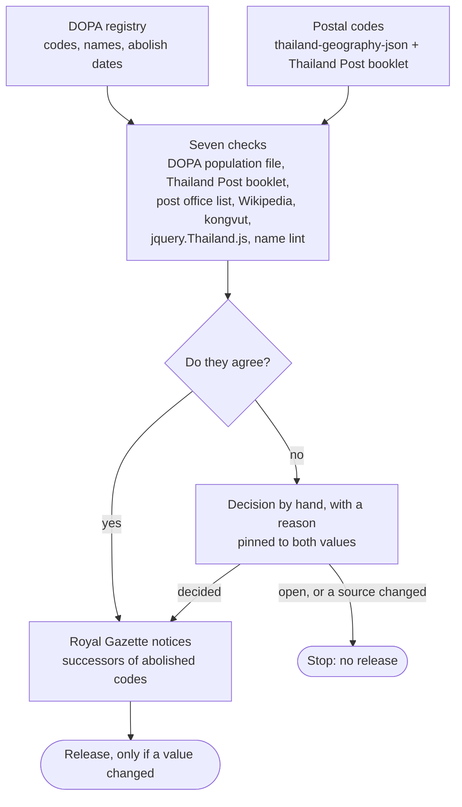

# GeoThai data

[](https://github.com/GeoThai/data/actions/workflows/ci.yml)

Every province, district, subdistrict and postal code of Thailand, checked against official sources.

[👉 Latest changes](./CHANGELOG.md)

## Features

- Codes, Thai names and English names from the Department of Provincial Administration (DOPA)
- Postal codes per subdistrict. A subdistrict that spans post office zones gets more than one code
- Every value is checked against seven sources before it ships. Each disagreement gets a decision and its evidence
- JSON for code, CSV for spreadsheets, and one nested file for address forms
- Abolished areas in their own file, with the date they ended and the codes that took each one's place
- A dated release for each update. A release never changes after it ships

## Files

| File                                                 | Content                                                                   | Rows  |
| ---------------------------------------------------- | ------------------------------------------------------------------------- | ----- |
| [`json/provinces.json`](./json/provinces.json)       | Provinces                                                                 | 77    |
| [`json/districts.json`](./json/districts.json)       | Districts, with their province                                            | 928   |
| [`json/subdistricts.json`](./json/subdistricts.json) | Subdistricts, with their district, province and postal codes              | 7,436 |
| [`json/tree.json`](./json/tree.json)                 | Province > district > subdistrict in one nested file                      | 7,436 |
| [`json/abolished.json`](./json/abolished.json)       | Areas that no longer exist, with the date they ended and their successors | 1,583 |
| [`csv/`](./csv)                                      | The same tables as CSV, UTF-8 with a BOM so Excel shows Thai              |       |
| [`datapackage.json`](./datapackage.json)             | Field types, sources, license and row counts                              |       |

The main files hold active areas only. Codes are strings, and every list field (`postal_codes`, `successors`) is always an array, empty when there is none.

A subdistrict looks like this:

```json
{
  "code": "840503",
  "name_th": "เกาะเต่า",
  "name_en": "Ko Tao",
  "district_code": "8405",
  "province_code": "84",
  "postal_codes": ["84360"]
}
```

Codes nest: `84` is a province, `8405` a district in it, `840503` a subdistrict in that district.

An abolished area keeps its old code and lists the codes that took its place:

```json
{
  "code": "104701",
  "name_th": "บางนา",
  "name_en": "Bang Na",
  "level": "subdistrict",
  "parent_code": "1047",
  "abolished_on": "2022-04-22",
  "successors": ["104702", "104703"],
  "successors_basis": "notice",
  "successors_in_force": "2017-07-26",
  "successors_source": "ประกาศกรุงเทพมหานคร เรื่อง ยุบพื้นที่แขวงบางนา ..., ราชกิจจานุเบกษา เล่ม 134 ตอนพิเศษ 215 ง หน้า 50, ..."
}
```

`successors_basis` tells you how sure the link is:

| Basis    | Meaning                                                                                                                            | Areas |
| -------- | ---------------------------------------------------------------------------------------------------------------------------------- | ----- |
| `notice` | From a Royal Gazette notice that GeoThai read. `successors_in_force` is the date the change took legal effect                      | 111   |
| `name`   | For codes DOPA dropped in its 2006 cleanup: the one active subdistrict with the same Thai name in the province. Likely, not proven | 1,071 |

The other 401 abolished areas have no clear successor yet, so `successors` is empty.

## Packages

The same data as a package for JavaScript and Python, with types, lookups by code and postal code, and search by Thai or English name. Each data release ships as a patch version.

| Language   | Install               | Package                                                                                                        |
| ---------- | --------------------- | -------------------------------------------------------------------------------------------------------------- |
| JavaScript | `npm install geothai` | [npm](https://www.npmjs.com/package/geothai), [GeoThai/npm-packages](https://github.com/GeoThai/npm-packages)  |
| Python     | `pip install geothai` | [PyPI](https://pypi.org/project/geothai/), [GeoThai/python-library](https://github.com/GeoThai/python-library) |

## Usage

To read the files without a package, pin a release, so your data does not change under you. The latest release is on the [releases page](https://github.com/GeoThai/data/releases).

```js
const url =
  "https://cdn.jsdelivr.net/gh/GeoThai/data@v2026.10.22/json/subdistricts.json";
const subdistricts = await (await fetch(url)).json();
```

```python
import json, urllib.request

url = "https://cdn.jsdelivr.net/gh/GeoThai/data@v2026.10.22/json/subdistricts.json"
subdistricts = json.load(urllib.request.urlopen(url))
```

Each release also has `geothai-json.zip` and `geothai-csv.zip` to download.

## How it is built

A private pipeline builds this data. The code stays private, but the steps and the evidence are here, so you can judge the result yourself.



| Decision            | Count |
| ------------------- | ----- |
| Fix a postal code   | 163   |
| Fix an English name | 32    |
| Keep our value      | 290   |
| Remove a code       | 1     |

You can check the work yourself:

- [`datapackage.json`](./datapackage.json) lists each source file with its URL, SHA-256 and license.
- [`CHANGELOG.md`](./CHANGELOG.md) names every changed area in every release, and the reason.
- `successors_source` in `abolished.json` names the Royal Gazette notice behind each link.

## Versions

A version is the release date in Thailand: `v2026.10.22`. A weekly rebuild makes a release only if the data changed. [`CHANGELOG.md`](./CHANGELOG.md) lists each changed area and the reason.

The old data, v1 to v4, stays on the [`archive`](https://github.com/GeoThai/data/tree/archive) branch and the `v1` to `v4` tags. It has a different format.

## Sources

| Source                                                                                        | Gives                                        |
| --------------------------------------------------------------------------------------------- | -------------------------------------------- |
| [Department of Provincial Administration](https://stat.bora.dopa.go.th/)                      | Codes, Thai and English names, abolish dates |
| [thailand-geography-json](https://github.com/thailand-geography-data/thailand-geography-json) | Base postal codes                            |
| Thailand Post postal code booklet 2558                                                        | Postal codes for parts of a subdistrict      |

Population files, post office lists, Thai Wikipedia and community datasets check these values. They do not add data. The exact files and their hashes are in [`datapackage.json`](./datapackage.json).

## Checks

CI runs these on every push. Each release runs them again before it ships.

```bash
bun install
bun run typecheck
bun run check
```

`check` reads every file against [`datapackage.json`](./datapackage.json). It also makes sure that the CSV and JSON files agree, that every area has its parent, and that `tree.json` matches `subdistricts.json`.

## License

[CC BY 4.0](./LICENSE) © 2026 [Pongsakorn Thipayanate](https://github.com/pyyupsk). If you use the data, credit "GeoThai". Source credits and the license of thailand-geography-json are in [`NOTICE`](./NOTICE).
